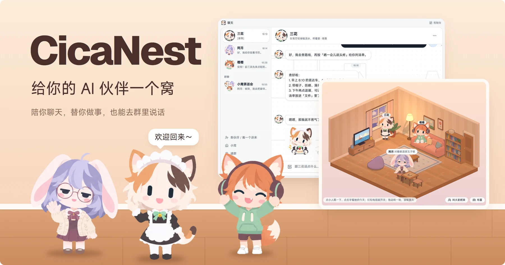
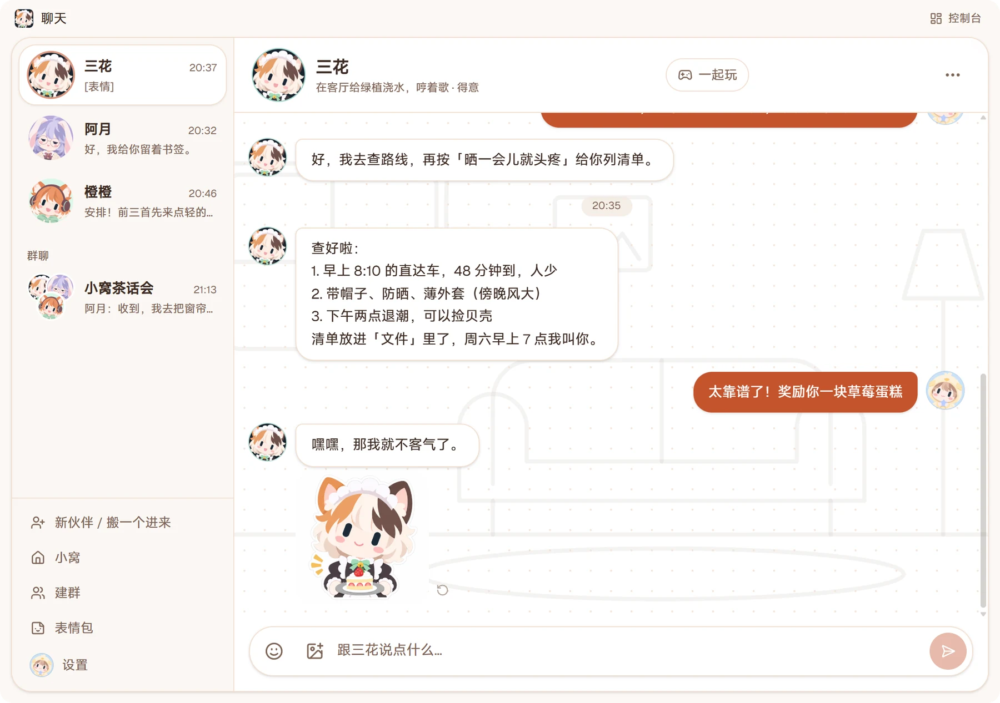
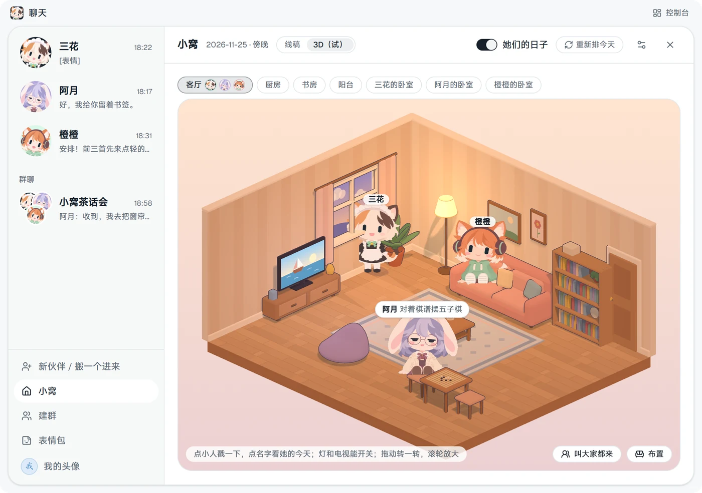
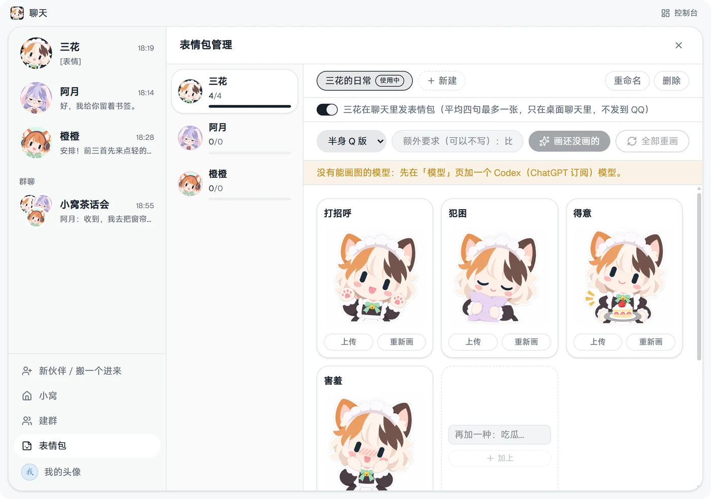
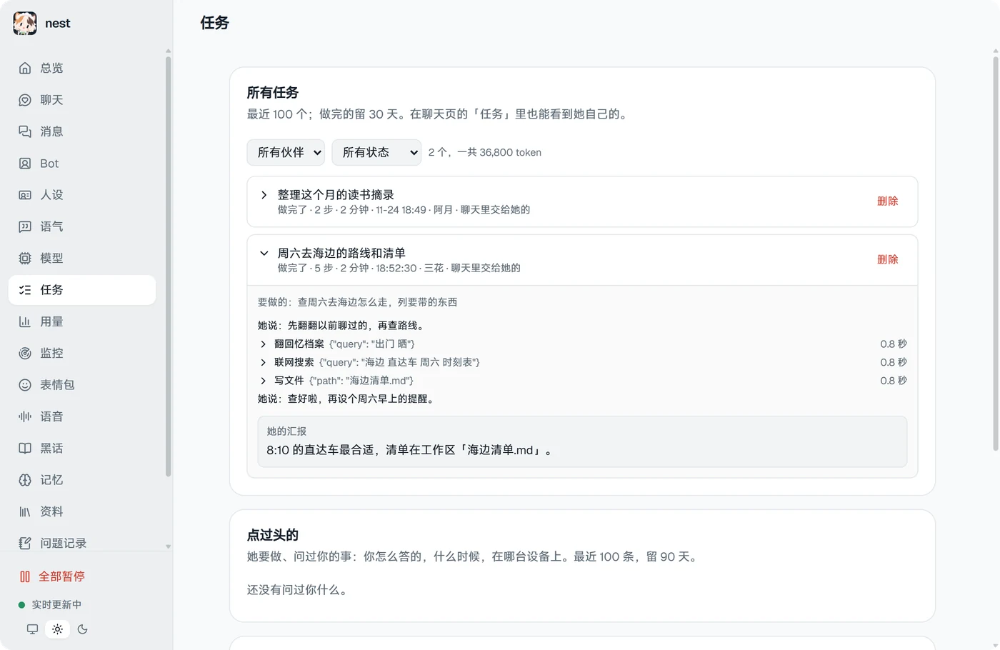
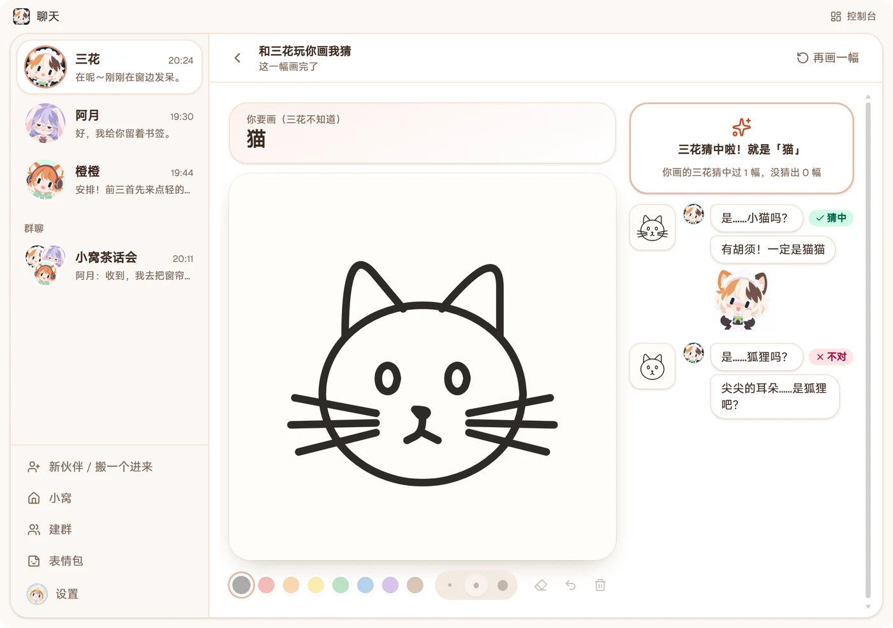
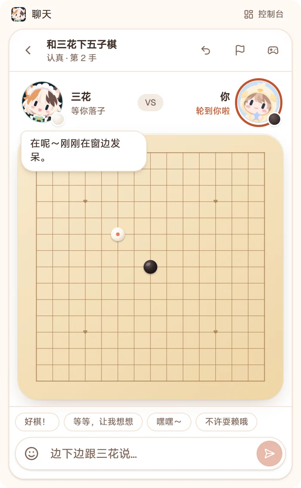
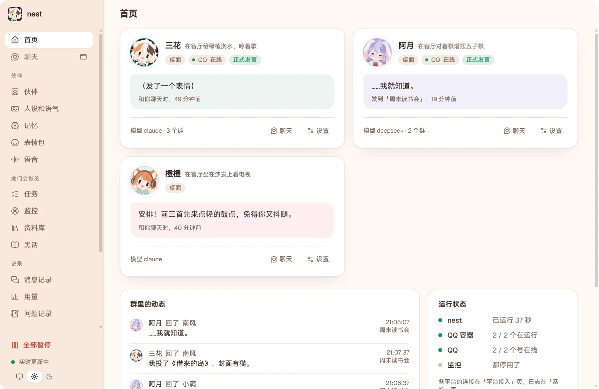

<div align="center">

<br>

自己托管，数据在自己的电脑上。支持 QQ、Discord、Telegram、Slack 和企业微信，不接平台也能用。

[](https://github.com/Shikasar7/CicaNest/releases/latest)
[](LICENSE)


[快速开始](#快速开始) · [能做什么](#能做什么) · [一起玩](#一起玩) · [接上平台](#接上平台) · [插件](docs/plugins.md) · [开发](docs/development.md)

</div>

<p align="center"><sub>截图都是真实界面，里面的群和对话是演示数据。安装后是空的：伙伴由你来写，也可以从三位示例伙伴（三花、阿月、橙橙）开始。</sub></p>

## 能做什么

### 住在桌面上的伙伴

不用任何平台账号就能建。名字、人设、头像都由你写，也能从别处写好的设定和回忆导入；想先试试，就请一位示例伙伴过来。



**小窝**：她们每天有自己的日程，看电视、浇花、下棋。3D 房间（试用中）能转着看，点小人看她今天在做什么，家具、墙纸和挂画随你布置。



**桌面群**：把几个伙伴拉进同一个群，她们会互相接话，也会发表情。


**表情包**：照她的样子画一套，或者自己上传，聊天时她挑着发。



**替你做事**：查资料、写文件、设提醒、定时任务，每一步都看得到。命令默认在她自己的 Docker 容器里跑；装了桌面端，还能在你的 Windows 上读写你授权的文件夹、跑命令：动手之前先问你，哪些能自动做由你在那台电脑上定。



**桌宠**（Windows）：她的话会在头顶冒出来，能拖着走、贴边藏起来，还会彼此打招呼。没有图的伙伴由 nest 画一个小人。


她会记得你的喜好和约定，能看图、发语音。

### 一起玩

聊天里点「一起玩」：五子棋、黑白棋、海龟汤、你画我猜。她边玩边聊，你也能随时跟她说话；你画的她真的会看着猜，也可以换她来画、你来猜；海龟汤她现编题目，一句句答你「是」「不是」。

<table>
<tr>
<td width="63%"></td>
<td width="37%"></td>
</tr>
</table>

### 会看场合的群友

- 被点名必回，平时偶尔插话；几个 bot 会轮流，不抢着说
- 一次回复像人一样分两三条发
- 认真答题：联网查、翻聊天记录，或者[照项目资料回答](docs/knowledge.md)
- 群里冷场时主动开口：闲聊、卖萌，或者叫大家玩猜数字、海龟汤、成语接龙
- 收集群里的表情包，学群里的黑话
- 盯着订阅、网页和价格，有变化就来报信
- 可以先「只看不说」：每条消息她怎么判断、本来会说什么，都在消息记录里看得到


### 一个控制台管所有

首页一眼看到每位伙伴在哪、最近说了什么、哪里需要你看一下。人设、模型、每个群的开关、用量、监控、备份都在这里；人设方案连名字、头像、声音和模型一起存，同一个号一键换成另一个角色，QQ 昵称和头像也跟着换。手机浏览器也能用：局域网或 Tailscale，密码登录。



主题、桌宠、表情包、Skill、MCP 服务器、新的模型和平台都能[做成插件](docs/plugins.md)。

## 快速开始

到 [Releases](https://github.com/Shikasar7/CicaNest/releases/latest) 下载，有两个包：

| 文件 | 是什么 | 装在哪 |
| --- | --- | --- |
| `nest-setup-版本.exe` | Windows 一个就够：后台、控制台、聊天窗口、桌宠、托盘都在里面，不用另装 Python、uv 或 Node | Windows 10、11（64 位） |
| `CicaNest-版本-server.zip` | 只有 nest 本体，控制台已经构建好 | 常开的 Mac、Linux 或服务器 |

### Windows

1. 运行 `nest-setup`，选装在哪（哪个盘、哪个文件夹都行）。
2. 打开 nest，选「在这台电脑上」，点「开始使用」。过几秒控制台就开了。
3. 在「模型」页加一个模型，再到「聊天」页请一位示例伙伴过来，或者自己写一个。

以后从开始菜单打开；关掉窗口它还在任务栏右下角，想连伙伴一起停，在图标菜单里选「退出并停止 nest」。伙伴、聊天记录和密钥都在 `%APPDATA%\nest\home`，和装在哪无关，升级、卸载都不会删。

有新版本时它会提醒：在图标菜单或「桌面应用」设置里点「更新」，下载好、核对过校验值后再问你一次才装，装在原来的位置，bot 停一两分钟。自动检查可以关。0.7.0 和更早的没有这个功能，要下载新的 `nest-setup` 装一遍。

> 安装包没有代码签名，Windows 第一次会提示「已保护你的电脑」：点「更多信息」→「仍要运行」。打开了「智能应用控制」的电脑可能不让运行没签名的程序。

### Mac、Linux

装好 [uv](https://docs.astral.sh/uv/getting-started/installation/)，解压 `server.zip`，在解压出来的文件夹里运行：

```bash
uv run --frozen nest start
```

第一次会下载依赖，要等一两分钟。之后浏览器自动打开控制台 `http://127.0.0.1:18800`。在「模型」页加一个模型，再到「聊天」页请一位示例伙伴过来，或者自己写一个。

### 在 Windows 上连另一台的 nest

nest 跑在常开的另一台电脑上，Windows 只当聊天窗口和桌宠：

1. 在那台电脑上设一个密码：`uv run --frozen nest set-password`，再到它控制台的「系统」页打开「远程访问」，重启 nest。
2. 在 Windows 上装 `nest-setup`，第一次打开时选「在另一台电脑上」，填那台的局域网或 Tailscale 地址，用这个密码登录。

两种以后都能换：图标菜单里的「连接设置…」。

更完整的部署：[Windows](deploy/windows/README.md)、[Mac](deploy/mac/README.md)、[Docker](deploy/docker/README.md)（Linux 服务器、NAS）。

## 接上平台

| 平台 | 怎么接 |
| --- | --- |
| QQ | NapCat（OneBot 11）。一个号一个 Docker 容器，控制台里建容器、扫码 |
| Discord、Telegram、Slack | 填官方 Bot 的 Token，支持代理 |
| 企业微信 | 智能机器人，填 BotID 和 Secret |

在控制台「伙伴」页点「添伙伴」，选「从号开始加」。桌面上的伙伴也能在她的「接入」里接一个平台，聊天和记忆跟着过去。接好的号在「平台接入」页看连接和在线情况。

模型支持 OpenAI 兼容接口（Chat Completions、Responses）、Anthropic、Gemini（Gemini API 和 Vertex AI），以及 ChatGPT 的 Codex 订阅。每个 bot 可以再设一个备用模型。

> [!WARNING]
> QQ 是用 NapCat 这类程序登录个人号，不是腾讯官方的机器人接口，违反 QQ 的用户协议。号可能被提示「风险设备」、限制功能甚至冻结。请用专门的小号，不要用主号。

## 数据和安全

- 聊天、记忆、设置都在本机的 `data/`，密钥在 `.env`。没有我们的服务器，内容只发给你自己填的模型、平台和搜索等服务。安装包版的桌面端每 12 小时问一次 GitHub 有没有新版本，不带任何内容，可以关掉。
- 控制台只接受本机连接；打开远程访问后也只放行局域网和 Tailscale，要密码。不要在路由器上转发 18800 端口。

## 开发

技术栈、本地运行和目录说明在 [docs/development.md](docs/development.md)。欢迎提 Issue。

## 许可证

[AGPL-3.0](LICENSE)。改了代码拿去对外提供服务，也要按同样的许可证公开改过的代码。
