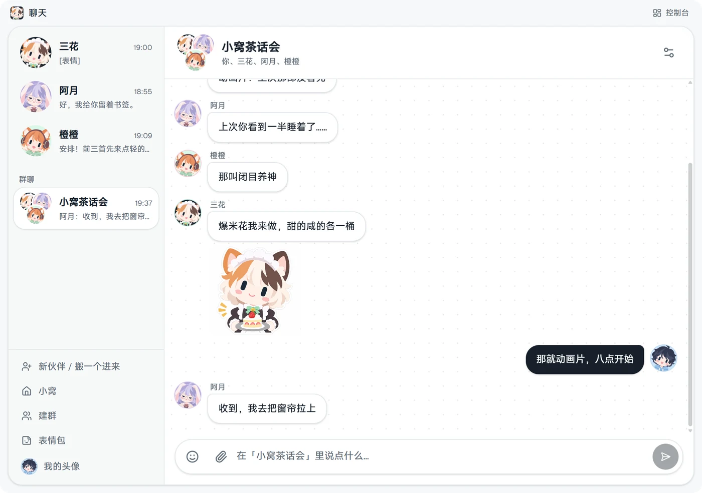
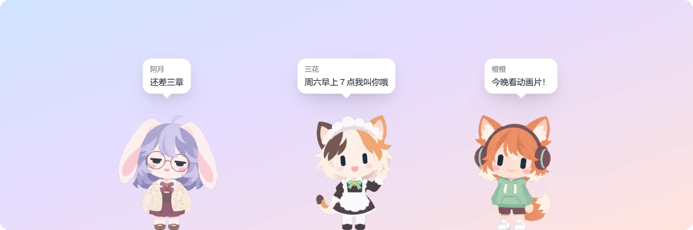
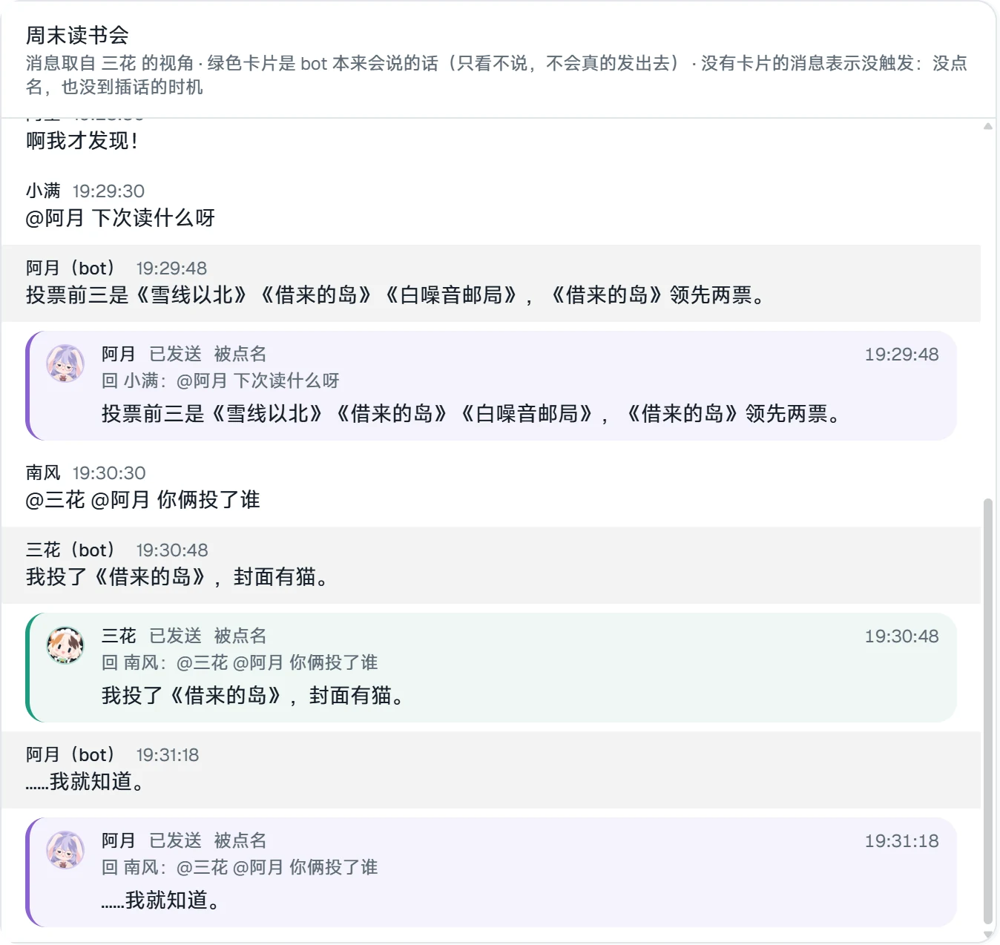
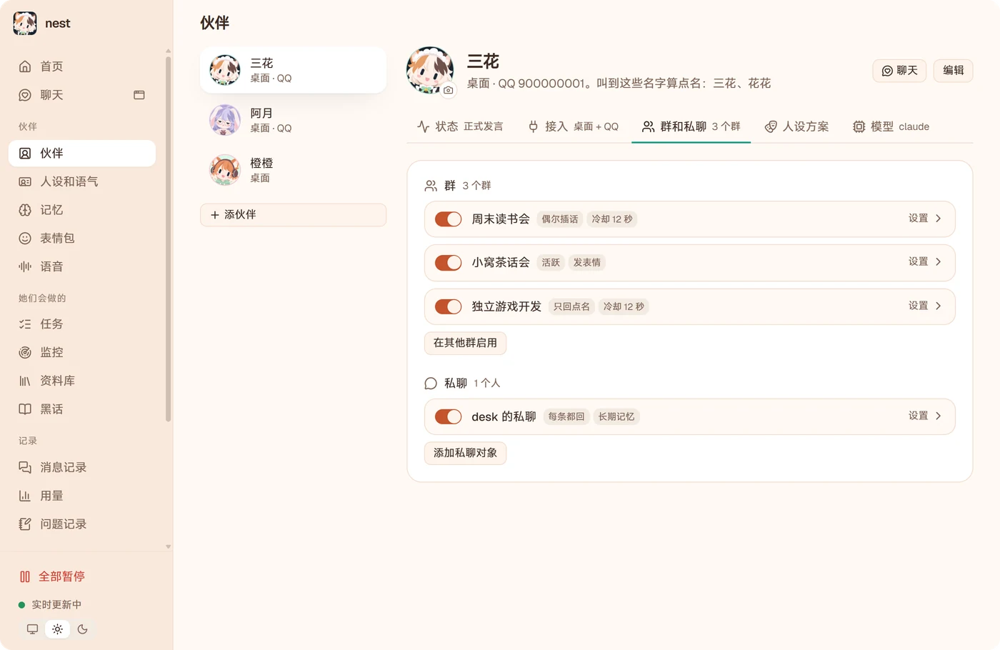
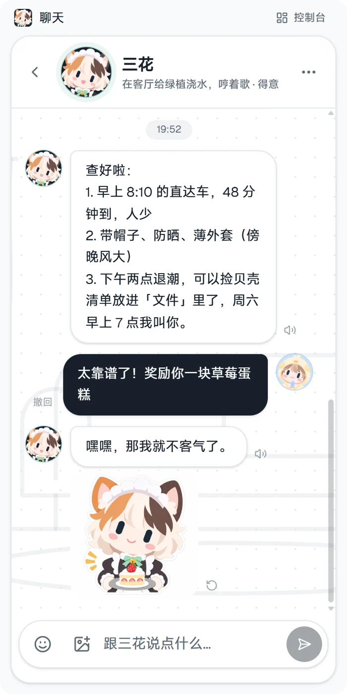

<picture>
  <source media="(prefers-color-scheme: dark)" srcset="docs/images/hero-dark.webp">
  
</picture>

<div align="center">

<br>

自己托管，数据在自己的电脑上。支持 QQ、Discord、Telegram、Slack 和企业微信，不接平台也能用。

[](https://github.com/Shikasar7/CicaNest/releases/latest)
[](LICENSE)


[快速开始](#快速开始) · [能做什么](#能做什么) · [接上平台](#接上平台) · [插件](docs/plugins.md) · [开发](docs/development.md)

</div>

<p align="center"><sub>截图都是真实界面，里面的伙伴、群和对话是演示数据。安装后是空的：伙伴由你来写。</sub></p>

## 能做什么

### 住在桌面上的伙伴

不用任何平台账号就能建。名字、人设、头像都由你写，也能从别处写好的设定和回忆导入。可以发表情包、图片和语音，也可以把几个伙伴拉进同一个群。

<picture>
  <source media="(prefers-color-scheme: dark)" srcset="docs/images/chat-dark.webp">
  
</picture>

<table>
<tr>
<td width="50%"></td>
<td width="50%"></td>
</tr>
<tr>
<td><b>小窝</b>：每天有自己的日程，看电视、浇花、下棋。3D 房间（试用中）里的家具、墙纸和挂画随你布置。</td>
<td><b>桌面群</b>：你和几个伙伴一起聊，她们会互相接话。</td>
</tr>
<tr>
<td></td>
<td></td>
</tr>
<tr>
<td><b>表情包</b>：照她的样子画一套，或者自己上传，聊天时挑着发。</td>
<td><b>替你做事</b>：查资料、写文件、设提醒、定时任务，每一步都看得到。</td>
</tr>
</table>



**桌宠**（Windows）：她的话会在头顶冒出来，能拖着走、贴边藏起来，还会彼此打招呼。没有图的伙伴由 nest 画一个小人。

她会记得你的喜好和约定。命令默认在她自己的 Docker 容器里跑；装了桌面端，还能在你的 Windows 上读写你授权的文件夹、跑命令：动手之前先问你，哪些能自动做由你在那台电脑上定。

### 会看场合的群友

<table>
<tr>
<td width="56%"></td>
<td>

- 被点名必回，平时偶尔插话；几个 bot 会轮流，不抢着说
- 一次回复像人一样分两三条发
- 认真答题：联网查、翻聊天记录，或者[照项目资料回答](docs/knowledge.md)
- 收集群里的表情包，学群里的黑话
- 盯着订阅、网页和价格，有变化就来报信
- 可以先「只看不说」，看看她本来会说什么

</td>
</tr>
</table>

### 一个控制台管所有

<table>
<tr>
<td width="72%"></td>
<td width="28%"></td>
</tr>
<tr>
<td>人设、模型、每个群的开关、用量、监控、备份都在网页里。人设能存成方案，一键整套换。</td>
<td>手机浏览器也能用：局域网或 Tailscale，密码登录。</td>
</tr>
</table>

主题、桌宠、表情包、Skill、MCP 服务器、新的模型和平台都能[做成插件](docs/plugins.md)。

## 快速开始

到 [Releases](https://github.com/Shikasar7/CicaNest/releases/latest) 下载，有两个包：

| 文件 | 是什么 | 装在哪 |
| --- | --- | --- |
| `CicaNest-版本-server.zip` | nest 本体，控制台已经构建好 | 常开的那台电脑（Windows、Mac 或 Linux） |
| `nest-setup-版本.exe` | Windows 桌面端：聊天窗口、桌宠、托盘 | 你平时用的 Windows 电脑，连到上面那台 |

**第一步，跑起来。** 装好 [uv](https://docs.astral.sh/uv/getting-started/installation/)，解压 `server.zip`。Windows 双击 `启动.bat`；Mac 和 Linux 在解压出来的文件夹里运行：

```bash
uv run --frozen nest start
```

第一次会下载依赖，要等一两分钟。之后浏览器自动打开控制台 `http://127.0.0.1:18800`。

**第二步，有个伙伴。** 在「模型」页加一个模型，再到「聊天」页点「新伙伴」。

**第三步（可选），装桌面端。** 先给 nest 设一个密码：

```bash
uv run --frozen nest set-password
```

在 Windows 上装 `nest-setup`，打开后填 nest 的地址，再用这个密码登录。nest 在同一台电脑上就填 `127.0.0.1:18800`；在另一台上，先到那台控制台的「系统」页打开「远程访问」并重启 nest，再填它的局域网或 Tailscale 地址。

> 安装包没有代码签名，Windows 第一次会提示「已保护你的电脑」：点「更多信息」→「仍要运行」。

更完整的部署：[Windows](deploy/windows/README.md)、[Mac](deploy/mac/README.md)、[Docker](deploy/docker/README.md)（Linux 服务器、NAS）。

## 接上平台

| 平台 | 怎么接 |
| --- | --- |
| QQ | NapCat（OneBot 11）。一个号一个 Docker 容器，控制台里建容器、扫码 |
| Discord、Telegram、Slack | 填官方 Bot 的 Token，支持代理 |
| 企业微信 | 智能机器人，填 BotID 和 Secret |

都在控制台「Bot」页点「增加 bot」。桌面上的伙伴也能接一个账号，带着聊天和记忆搬过去。

模型支持 OpenAI 兼容接口（Chat Completions、Responses）、Anthropic，以及 ChatGPT 的 Codex 订阅。每个 bot 可以再设一个备用模型。

> [!WARNING]
> QQ 是用 NapCat 这类程序登录个人号，不是腾讯官方的机器人接口，违反 QQ 的用户协议。号可能被提示「风险设备」、限制功能甚至冻结。请用专门的小号，不要用主号。

## 数据和安全

- 聊天、记忆、设置都在本机的 `data/`，密钥在 `.env`。没有我们的服务器，内容只发给你自己填的模型、平台和搜索等服务。
- 控制台只接受本机连接；打开远程访问后也只放行局域网和 Tailscale，要密码。不要在路由器上转发 18800 端口。

## 开发

技术栈、本地运行和目录说明在 [docs/development.md](docs/development.md)。欢迎提 Issue。

## 许可证

[AGPL-3.0](LICENSE)。改了代码拿去对外提供服务，也要按同样的许可证公开改过的代码。
